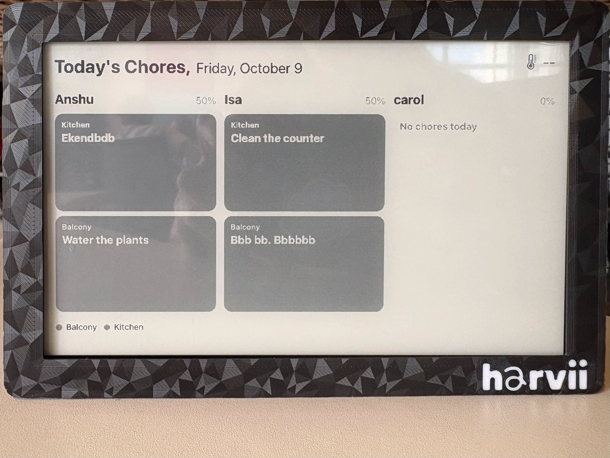
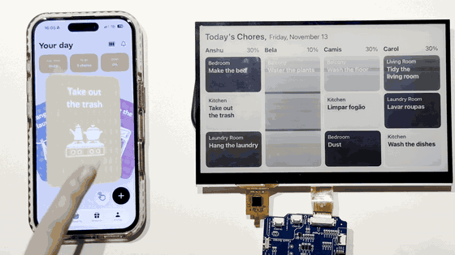
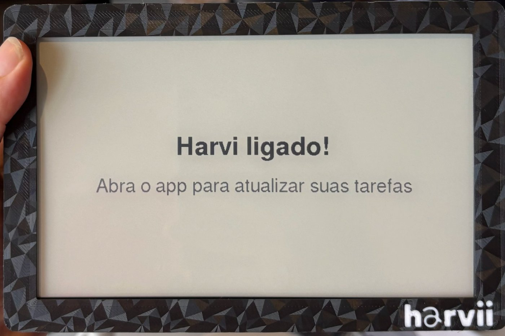
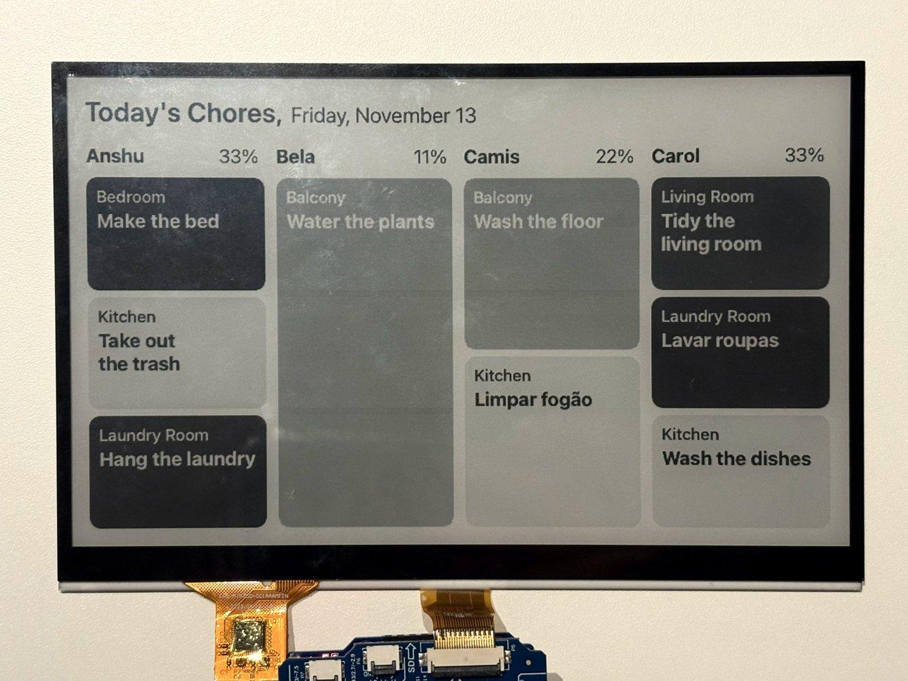
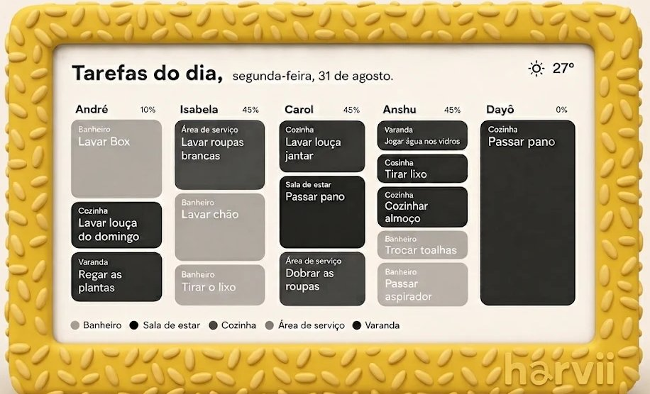
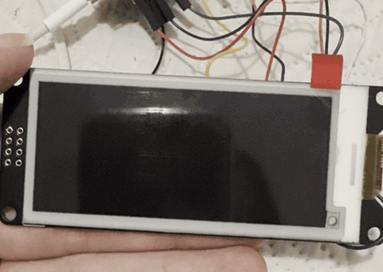
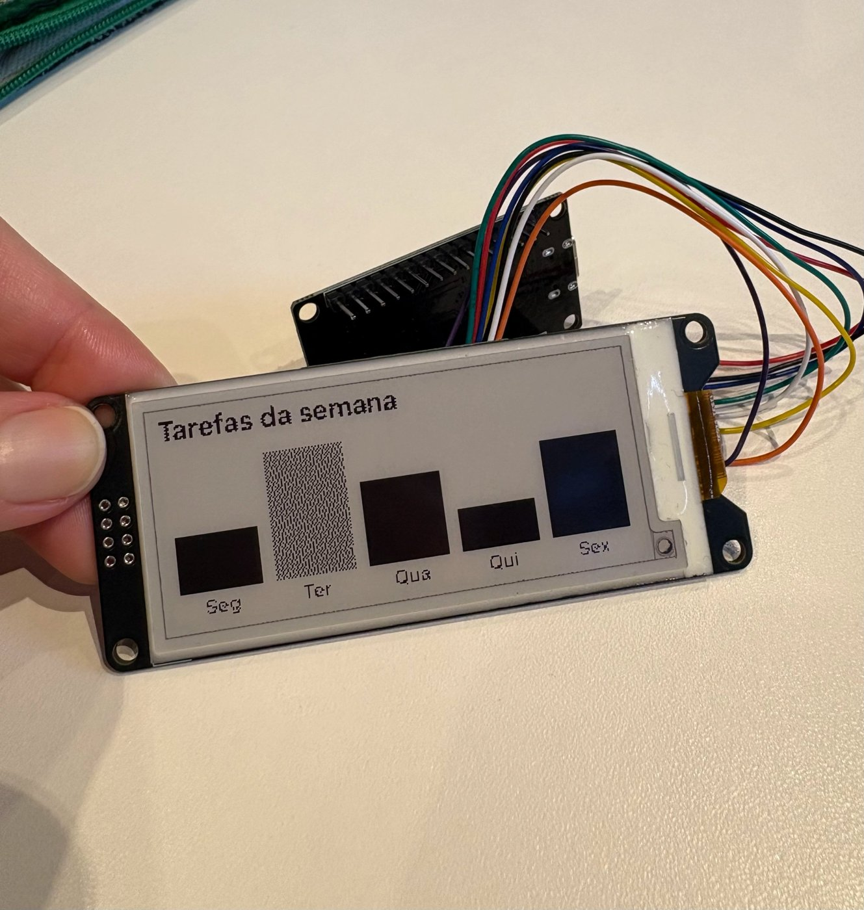
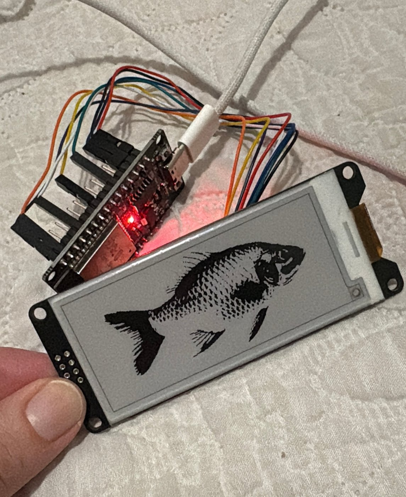
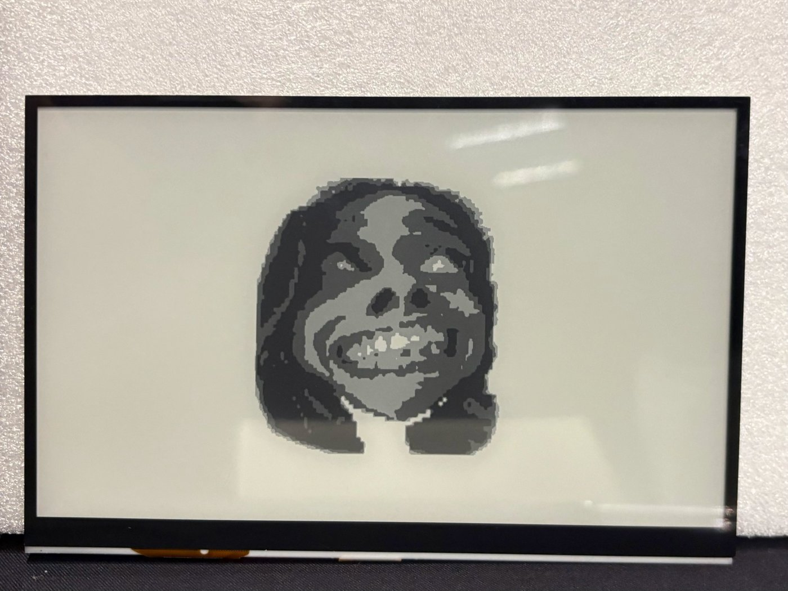
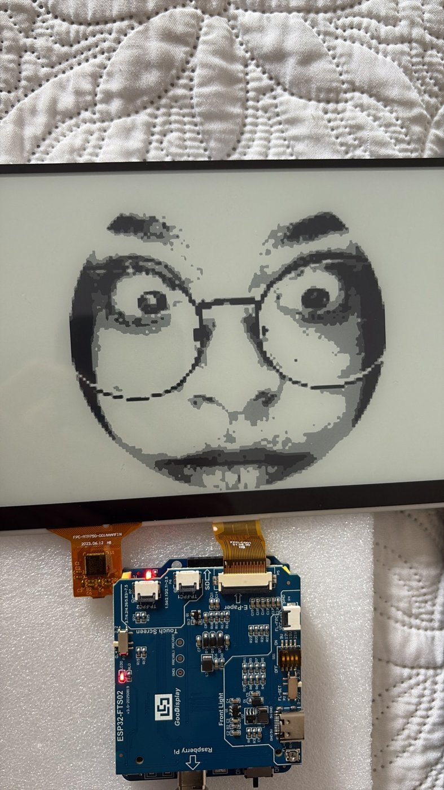

<div align="center">



# Harvii

### The house's chores, on the wall. 📟

Harvii is the e-paper companion of [**Pipa: Para Partilhar**](https://github.com/MegaFinal/Cognitive-Work).
An ESP32 with a 7.5" e-paper screen that hangs on the wall and shows what each roommate has
to do today, so nobody needs to open their phone. It updates over Wi-Fi whenever something
changes in the app.

<br/>

[](https://apps.apple.com/br/app/pipa-para-partilhar/id6799178383)
[](https://www.espressif.com/en/products/socs/esp32)
[](https://www.arduino.cc/)
[](https://isocpp.org/)
[](https://github.com/ZinggJM/GxEPD2)

</div>

---

## 📑 Table of Contents

- [About](#-about)
- [Demo](#-demo)
- [Photos](#-photos)
- [Features](#-features)
- [How It Works](#-how-it-works)
- [HTTP API](#-http-api)
- [Hardware](#-hardware)
- [Tech Stack](#-tech-stack)
- [Project Structure](#-project-structure)
- [Getting Started](#-getting-started)
- [Authors](#-authors)

---

## 📖 About

Chores that live only on a phone are easy to forget. Harvii takes the division made by
**Pipa** off the screen and puts it where the whole house sees it: one column per roommate,
the chores of the day shaded by room, each person's share of the day, and the late chores
right below the current ones.

The screen is **e-paper**: the image stays on even without power, uses almost no energy and
reads like paper, which suits an object that stays on the wall all day.

> Harvii is not for sale yet. It's being developed as an accessory for Pipa.

---

## 🎬 Demo

<div align="center">



<sub>A chore marked as done in Pipa, and Harvii redrawing the day's chores.</sub>

</div>

---

## 📸 Photos

<div align="center">





<sub>Harvii after pairing, the 7.5" panel with its ESP32 board, and a render of the yellow case we made.</sub>

</div>

### From prototype to Harvii

<div align="center">








<sub>"Hello, World" on a 2.9" e-paper wired to an ESP32, the first images, and the first photos
sent from the phone to test the 4 gray levels on the 7.5" panel.</sub>

</div>

---

## 🚀 Features

- **📶 Wi-Fi setup from the app** — on first boot Harvii opens its own access point (`HARVII`); the app sends the home Wi-Fi credentials and Harvii joins the network.
- **🔐 Pairing** — each phone pairs with a UUID key kept in flash; every request that changes the screen must send it.
- **🔎 Discovery with Bonjour** — Harvii announces itself as `harvi-xxxx.local` over mDNS, so the iPhone finds it without depending on its IP.
- **🖼️ Streaming image upload** — the 96 KB image is drawn band by band as it arrives, using a ~9.6 KB buffer instead of holding the whole frame in RAM.
- **🔄 Knows when it's outdated** — after a reboot, a reconnection or a status message, Harvii asks the app to send the chores again (`needsRefresh`).
- **📡 Connection monitoring** — if the home Wi-Fi drops, the screen says so and Harvii keeps retrying until it's back.
- **♻️ Factory reset** — from the app, or by holding the **BOOT** button for 5 seconds; it erases the Wi-Fi and the pairing key.
- **🔋 Low power** — CPU at 160 MHz instead of 240 MHz, and the e-paper only draws when the image changes.

---

## ⚙️ How It Works

1. **First boot** — Harvii has no Wi-Fi saved, so it opens the `HARVII` access point and shows the setup instructions on screen.
2. **Send the Wi-Fi** — the phone joins `HARVII` and the app posts the home network credentials to `/save_wifi`. Harvii answers with its name (`harvi-xxxx`) and connects to the home network.
3. **Find and pair** — back on the home network, the app reaches `harvi-xxxx.local` through Bonjour and asks for the pairing key (`/ask_code`). The name is saved in CloudKit, so every roommate's phone can find the same Harvii.
4. **Draw the chores** — the app renders the dashboard in SwiftUI (`ImageRenderer`, 800×480), converts it to a **2-bit-per-pixel** bitmap and posts it to `/send_image`.
5. **Stay current** — the app checks `/status` and sends a new image whenever the chores change or Harvii asks for one.

### Image format

| | |
|---|---|
| Size | 800 × 480, landscape |
| Depth | 2 bits per pixel, MSB first (4 pixels per byte) |
| Levels | `0` black · `1` dark gray · `2` light gray · `3` white |
| Bytes | 200 per row · **96,000** per image |

The app dithers between neighbouring levels, so the 4 grays read as 7 tones on the panel.

Harvii answers the upload **before** refreshing the panel (a full refresh takes a few
seconds). Since the ESP32 handles one request at a time, a `/status` call right after the
upload only returns once the drawing is done, which is how the app knows the screen is ready.

---

## 🌐 HTTP API

Port 80. Responses are JSON: `{ "success": bool, "message": string }`.

| Method | Path | Auth | Body | Description |
|--------|------|------|------|-------------|
| `POST` | `/save_wifi` | — | `{ "ssid", "password" }` | Saves the home Wi-Fi and connects. Returns the device `name`. |
| `GET` | `/ask_code` | — | — | Returns the pairing key in `message`. |
| `POST` | `/send_image` | `X-Auth-Hash` | 96,000 raw bytes | Draws a full-screen image. |
| `POST` | `/send_text` | `hash` in body | `{ "hash", "messageOne", "messageTwo" }` | Shows a centered title and subtitle. |
| `GET` | `/status` | `X-Auth-Hash` | — | `needsRefresh`: whether the app should send the chores again. |
| `POST` | `/reset` | `X-Auth-Hash` | — | Factory reset. |

---

## 🔌 Hardware

| Part | Model |
|------|-------|
| Board | GooDisplay **ESP32-FTS02** e-paper driver board |
| Screen | GooDisplay **GDEY075T7**, 7.5" · 800×480 · 4-level grayscale |
| Frame | 3D-printed |
| Power | USB-C |

Display pins are set in [`main/config.h`](main/config.h).

---

## 🛠️ Tech Stack

| Area | Tech |
|------|------|
| Firmware | C++ · Arduino framework · ESP32 Arduino core |
| Display | GxEPD2 (`GxEPD2_4G_4G`) · Adafruit GFX · SPI |
| Networking | WiFi (AP + STA) · WebServer · ESPmDNS (Bonjour) |
| Data | ArduinoJson · Preferences (NVS flash) |
| Companion app | [Pipa](https://github.com/MegaFinal/Cognitive-Work) (SwiftUI · CloudKit) |

---

## 📂 Project Structure

```
main/
├── main.ino          # setup() and loop()
├── config.h          # Pins, panel size, access point and reset settings
├── display.cpp/.h    # E-paper driver: text screens and band-by-band image drawing
├── wifi_manager.*    # Access point, home Wi-Fi connection, reconnection and mDNS
├── web_server.*      # HTTP API and the streaming image upload
├── auth.*            # Pairing key (UUID v4) kept in flash
└── reset.*           # Factory reset (API or BOOT button)
docs/images/          # Photos and GIFs used in this README
```

---

## 🎯 Getting Started

### Requirements

- [Arduino IDE 2](https://www.arduino.cc/en/software) (or `arduino-cli`)
- The **esp32** board package by Espressif
- Libraries: **GxEPD2**, **Adafruit GFX Library** and **ArduinoJson** (v7)

### Flash

1. Clone the repository:
   ```bash
   git clone https://github.com/MegaFinal/Cognitive-work-hardware.git
   ```
2. Open `main/main.ino` in the Arduino IDE.
3. Select your ESP32 board and port, then **Upload**.
4. On first boot the screen shows the setup instructions. Pair it from the **Pipa** app (Profile → Harvii).

Serial logs run at **115200** baud.

---

## 👥 Authors

Part of **Pipa**, built at the **Apple Developer Academy | Mackenzie**.

<table width="100%">
  <tr>
    <td align="center" width="16%">
      <a href="https://github.com/Anshushu000"></a>
      <br/><sub><b>Anshu Li</b></sub><br/>
      <a href="https://github.com/Anshushu000"></a>
      <a href="https://www.linkedin.com/in/anshu-li/"></a>
    </td>
    <td align="center" width="16%">
      <a href="https://github.com/camilatoniato"></a>
      <br/><sub><b>Camila Toniato</b></sub><br/>
      <a href="https://github.com/camilatoniato"></a>
      <a href="https://www.linkedin.com/in/camilatoniato/"></a>
    </td>
    <td align="center" width="16%">
      <a href="https://github.com/carolssun"></a>
      <br/><sub><b>Carolina Sun</b></sub><br/>
      <a href="https://github.com/carolssun"></a>
      <a href="https://www.linkedin.com/in/carolina-sun/"></a>
    </td>
    <td align="center" width="16%">
      <a href="https://github.com/dayoleal"></a>
      <br/><sub><b>Dayô Araújo</b></sub><br/>
      <a href="https://github.com/dayoleal"></a>
      <a href="https://www.linkedin.com/in/dayo-araujo/"></a>
    </td>
    <td align="center" width="16%">
      <a href="https://github.com/hissapinto"></a>
      <br/><sub><b>Isabela Hissa</b></sub><br/>
      <a href="https://github.com/hissapinto"></a>
      <a href="https://www.linkedin.com/in/hissapinto/"></a>
    </td>
    <td align="center" width="16%">
      <a href="https://github.com/JonasFNMelo"></a>
      <br/><sub><b>Jonas Melo</b></sub><br/>
      <a href="https://github.com/JonasFNMelo"></a>
      <a href="https://www.linkedin.com/in/jonas-melo-/"></a>
    </td>
  </tr>
</table>
